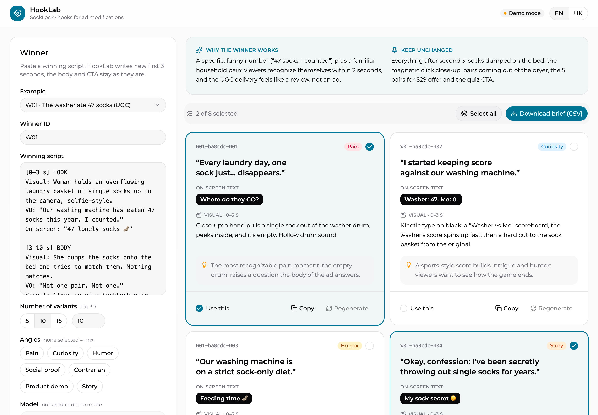

# HookLab: hooks for ad modifications

[Українська версія](README.uk.md)



HookLab takes the script of a winning video ad and in about a minute suggests new first 3 seconds for modifications: the visual, the first line and the on-screen text. The body and CTA stay as in the winner. The designer clicks the variants they'll use, regenerates individual ones if needed (“more dramatic”, “shorter”, a free-form note) and downloads a brief as CSV. Claude and GPT models are connected through OpenRouter and can be switched in the form. The interface is available in English and Ukrainian.

Built as an MVP for a MarTech homework assignment around a fictional DTC brand, SockLock (magnetic socks that don't get lost in the wash).

**The problem it solves.** Motion designers spend about half of the 3 hours per modification rewriting hooks by hand. Scaling ad spend from $400k to $800k a month needs ~500 modifications a month, while the team makes 240. Freeing that time is worth an estimated +$55k expected gross profit a month in the base scenario.

## Quick start

Requires Node.js 20.12 or newer.

```bash
npm install
npm start
```

Open <http://localhost:3000>. `npm start` builds the web app and starts the server.

Without a key HookLab runs in **demo mode**: three sample winners with prepared example results, no model is called. To generate for any script, add an OpenRouter key:

```bash
cp .env.example .env
# put OPENROUTER_API_KEY into .env
npm start
```

### From the terminal

```bash
npm run cli -- data/winners/w01-laundry-monster.md --model opus --count 5 --angles pain,humor --lang en
```

`--model` takes a full ID or a short name: `sonnet`, `opus`, `sol`, `astra`. `--lang` sets the language of the CLI output (`en` or `uk`, default from `HOOKLAB_LANG`, otherwise English). The command prints the variants and saves the brief to `out/brief-<winner>-<run>.csv`.

### Developing the web app

```bash
npm run serve        # API server on :3000
npm run dev          # Vite dev server with hot reload, proxies /api to :3000
```

## How to use

1. Pick an example or paste your own script (ideally with timecodes: hook, body, CTA) and set the winner ID.
2. Choose the model and the number of variants: quick buttons 5, 10, 15 or any number up to 30. Optionally pick angles and add notes. The estimated cost is shown under the Generate button.
3. Click a card to select it. To rework a variant, press **Regenerate** on its card: pick quick tweaks (more dramatic, funnier, shorter, simpler, bolder visual, more UGC, different angle) and/or write a note. The new version gets a `mod_id` with a `v2`, `v3`… suffix.
4. Download the brief. Put the `mod_id` (e.g. `W01-7c0060-H03`) into the creative name in Meta, so the UA report can be matched to a specific hook.

The language switch in the header changes only the interface. The brief itself (hooks, visuals, reasoning, warnings) is always written in the language of the winning script: an English script gets an English brief, a German script a German one.

## Models

| Model | OpenRouter ID | Price per 1M tokens (in / out) | Measured cost |
|---|---|---|---|
| Claude Sonnet 5.5 (default) | `anthropic/claude-sonnet-5.5` | $2 / $10 | 5 variants — $0.04, 10 — $0.05, 30 — $0.10 (80 s) |
| Claude Opus 5.5 | `anthropic/claude-opus-5.5` | $4 / $20 | 5 — $0.07, 15 — $0.12 |
| GPT-6.1 Sol | `openai/gpt-6.1-sol` | $2 / $10 | 5 — $0.02, 15 — $0.04 |
| GPT-6 Astra | `openai/gpt-6-astra` | $10 / $50 | 5 — $0.12, 15 — $0.25 |

Regenerating one variant on Claude Sonnet 5.5 takes ~10 s and costs ~$0.02. To add a model, add an entry to `src/models.ts`.

### Cost estimate

Before a run, the estimated cost is shown under the Generate button, and the regenerate dialog shows the cost of one variant. After a run, the actual cost is shown next to the estimate so they can be compared.

How it's calculated (`src/estimate.ts`):

1. **Input tokens** = prompt length (system prompt + script + settings) ÷ characters per token for the model.
2. **Output tokens** = base + number of variants × tokens per variant. These numbers were measured per model on test runs of 5 to 30 variants and live in `src/models.ts`.
3. **Cost** = tokens × model price, with a range of −25% to +35%.
4. **Self-calibration:** after every live run, the estimate and the actual cost from OpenRouter are logged. The estimate is multiplied by the median ratio over the last 10 runs of that model, so it adapts to real data over time.

On the test runs the estimate was within 0–3% of the actual cost.

## How it works

```
winning script ─┐
brand guide    ─┼─> prompt ─> OpenRouter ─> Claude / GPT (structured output from a zod schema) ─> variants H01…H30
model, angles  ─┘                                                                                  │
      ↻ regenerating one variant: current version + quick tweaks + note ─> H03v2                    │
                     out/runs/<run>.json        <───────────────────────────────────────────────────┤
                     out/usage-log.jsonl        <───────────────────────────────────────────────────┤
                     CSV brief for designers    <───────────────────────────────────────────────────┘
```

| Path | What it does |
|---|---|
| `src/prompt.ts` | System prompt (what a modification is, requirements for variants, angles, Meta and brand guardrails), rewrite prompt and quick tweaks |
| `src/schema.ts` | Zod schemas of the responses. They generate the JSON Schema for structured outputs and validate model answers and demo examples |
| `src/models.ts` | Models for the form and CLI, their prices and cost-estimate coefficients |
| `src/estimate.ts` | Cost estimate before a run and its self-calibration from actual runs |
| `src/generate.ts` | OpenRouter call, generating a set, regenerating one variant, IDs and versions, cost, readable errors |
| `src/i18n.ts` | Server messages and CLI output in English and Ukrainian |
| `src/server.ts` | Framework-free HTTP server: serves the web app and `/api/generate`, `/api/regenerate`, `/api/estimate`, `/api/export`, `/api/winners`, `/api/status` |
| `src/cli.ts` | Generation from the terminal |
| `src/store.ts` | Saving runs and the event log for metrics |
| `src/csv.ts` | CSV brief |
| `web/` | React + Vite + Tailwind + shadcn/ui (preset `b1G2mZFZY`), UI strings in `web/src/lib/i18n.tsx` |
| `data/` | Brand guide, 3 sample winners and their demo examples. All data is fictional |

Requests go out with `provider.require_parameters: true`, so OpenRouter only routes them to providers that support structured outputs. The answer is validated with the zod schema once more.

## Success metrics

| Metric | Now | Target | When | How we measure |
|---|---|---|---|---|
| Designer time per modification | ~3 h | ≤ 2.2 h in the pilot, ~2 h after rollout | 2 weeks / 3 months | Designers' time tracking |
| Share of pilot designers' modifications made with HookLab | 0% | ≥ 50% | 2 weeks | `mod_id` in creative names |
| Share of generated variants taken into production | — | ≥ 30% | 2 weeks | `out/usage-log.jsonl`: `export.selected` / `generate.returned` |
| Regenerations per variant taken | — | ≤ 1 | 2 weeks | `out/usage-log.jsonl`: `regenerate` events / `export.selected` |
| Modifications per month | 240 | 300 → 360 | 1 / 3 months | Production report |
| Win rate of HookLab modifications | same as other modifications | not lower | 4 weeks | UA report, filtered by `mod_id` |
| ROMI | 135% overall | ≥ 130% on added spend, ≥ 125% overall | weekly | UA report |
| Business impact | — | +$55k expected gross profit a month | 3 months | Added spend × (ROMI − 100%) |

The pilot counts as a success if the time and adoption targets are met after 2 weeks and the win rate hasn't dropped after 4 weeks. Then we roll out to all six designers. In parallel we compare models: which one gives the highest share of used variants per dollar.

## Next iteration

1. **More modification types.** Besides the hook: the CTA, captions in the body, a shorter cut of the ad. Each type is a separate test with its own `mod_id`, so it stays clear what worked. Technically it's a prompt and a response schema per type; the form and the brief stay the same.

Items 2–4 close the loop “winner → hooks → task → result” without manual exports.

2. **Airtable.** Selected variants become designer tasks right away: brief, `mod_id`, winner, deadline. CSV stays as a fallback.
3. **Meta.** The tool detects winners by ROMI and CPA on its own, runs generation for them and creates tasks in Airtable. Results of modifications are pulled back by `mod_id`, and the best hooks become examples in the prompt.
4. **Slack.** Alerts about new winners and buttons to launch generation and other automations.
5. **Localization for DE and FR.** Cultural adaptation of hooks, not literal translation, plus a checklist for native-speaker review. This unblocks the European tests.

Next, a bigger bet:

6. **Video generation inside the tool**, growing into a creative builder: image and video generation, editing, subtitles.

## MVP limitations

- No access to Meta, Airtable or the SockLock backend: the input is script text, the output is CSV.
- Demo examples are prepared in advance and show the result format. Real generation and regeneration need an OpenRouter key.
- Hook quality is judged by the designer; there is no automatic Meta policy check yet.
- Runs are stored locally in `out/`, with no database or authentication.
